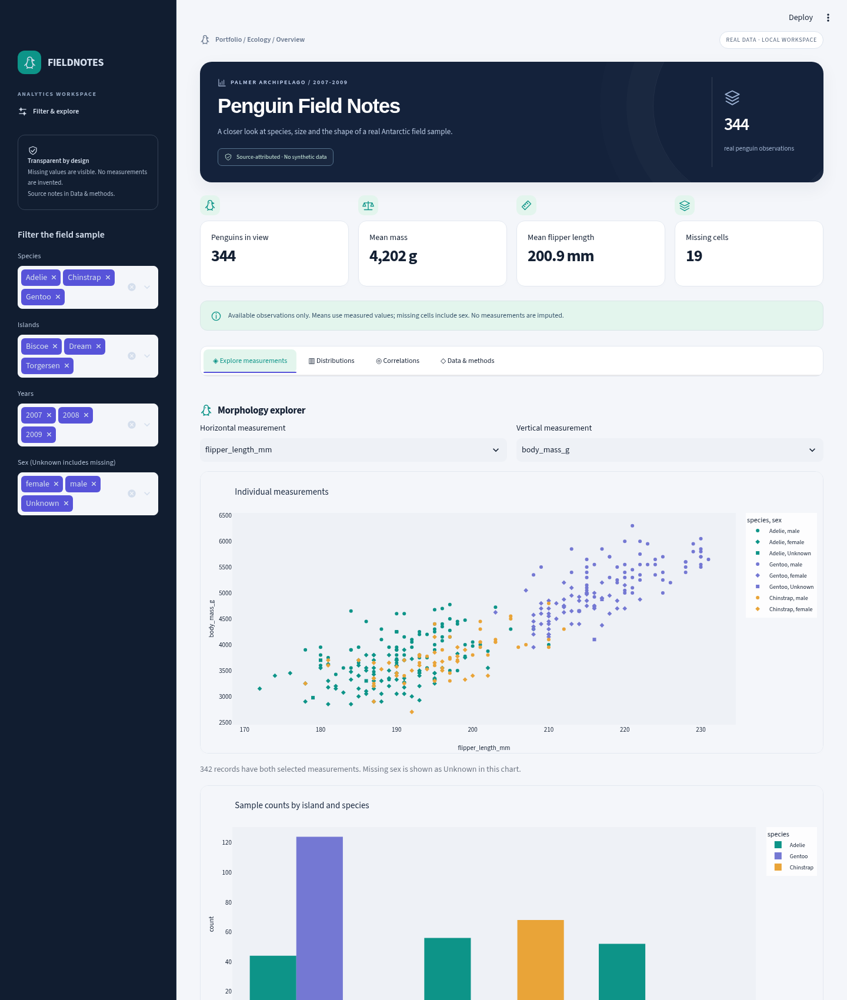

# Penguin Field Notes: exploratory data analysis

Explore body measurements, species differences, missing values and pooled versus within-group correlations.

شرح مختصر بالمصري في [EXPLAIN_AR.md](EXPLAIN_AR.md).

## Dataset, questions and method

**Data:** all 344 observations from Palmer Penguins; three species, three islands, 2007-2009. Source and CC0 attribution: https://github.com/allisonhorst/palmerpenguins . Horst, Hill and Gorman (2020); original measurements by Kristen Gorman and Palmer Station LTER. DOI: 10.5281/zenodo.3960218. See `data/provenance.json` for download URL and file checksum. No simulated measurements.

**Questions:** How do mass distributions differ? How does flipper length relate to mass? Does species composition change the pooled relationship? Where are measurements missing?

**Method:** schema validation, missingness audit, per-species count/mean/median/std, pairwise-complete Pearson correlations and measured-value visualizations. No blanket complete-case deletion and no imputation. Missing sex does not drop usable mass/flipper observations. Means and correlations do not establish causation or represent every penguin population.

## Setup

Tested with Python 3.10.12. Use Python 3.10 or 3.11 and a fresh virtual environment.
Run the following **inside this project folder**:

```bash
python -m venv .venv
# Windows PowerShell:
.venv\Scripts\Activate.ps1
# macOS / Linux:
source .venv/bin/activate
python -m pip install -r requirements.txt
python main.py
```

Choose only the activation command for your operating system. If PowerShell blocks activation,
you can use `.venv\Scripts\python.exe` instead of `python` for each command.
All input data is included or comes bundled with scikit-learn; running requires no account,
API key, paid service or dataset download. Installing dependencies needs an internet connection.
The pinned requirements record the tested direct dependencies, not every transitive dependency.
All paths are relative to the script, so main.py also works when launched elsewhere.

## Repository map

- `main.py`: commented, reproducible analysis/training pipeline.
- `data/`: original data or dataset description and attribution.
- `outputs/`: actual generated reports, metrics, charts and run log.
- `EXPLAIN_AR.md`: short Egyptian-Arabic walkthrough and interview prompts.
- `requirements.txt`: tested direct package versions.

Results below are from the included reproducible run, not invented targets.

## Interactive dashboard

```bash
python -m streamlit run dashboard.py --server.port 8502
```

Open the localhost URL in your terminal. This is local code, not a hosted website.

- Species, island, year and sex filters (including Unknown sex).
- Count, mean mass, mean flipper length and missing-cell KPI cards.
- Selectable scatterplot axes, species colors and sex symbols.
- Island/species sample composition, boxplots and overlapping histograms.
- Correlation heatmap with pairwise sample-count table.
- Pooled versus within-species correlation comparison.
- Missing-value chart, row browser and filtered CSV download.
- Honest empty-state messages if filters return no records.

## Reproduced results

### Penguins findings

- 344 penguins across three species; 342 have both mass and flipper measurements.
- Mean body mass: Adelie 3701 g, Chinstrap 3733 g, Gentoo 5076 g.
- Pooled Pearson correlation (flipper length vs mass): 0.871.
- Within-species correlations: Adelie 0.468, Chinstrap 0.642, Gentoo 0.703.

The pooled association is stronger than some within-species associations. Species mix matters;
a pooled correlation is not a causal effect. Samples come from particular islands and years,
not a random sample of every penguin population. No claim of statistical significance is made.
Missing sex values are not imputed, and do not exclude otherwise usable mass/flipper pairs.
The counts in species_statistics.csv are per measurement, not an invented common denominator.


## Tests and next steps

The downloadable five-project review bundle contains the integration test suite. This standalone repository can be verified with `python main.py` and its saved report. To rerun only this project: `python main.py`.

Before presenting this as your own work, understand each cleaning choice, explain every metric, and add a change you can defend. This is a ready-to-study portfolio starter, not a claim of client work or original data collection.

## Dashboard preview


## Visual design

A dedicated `design.py` supplies inline SVG icons (no CDN), a dark filter sidebar,
source-attributed hero, metric cards, consistent Plotly styling and hover/fade transitions.
Animations respect `prefers-reduced-motion`. Commerce uses indigo/teal; ecology uses teal/amber/violet.
The interface is polished without inventing business outcomes or work experience.

## Bundled data and reports

Real datasets and generated reports are compressed in the root `7-project-assets.zip` file.
`resources.py` verifies its SHA-256 and extracts it automatically the first time you run
`main.py` or the dashboard. No web request is made. A numeric prefix on the archive filename
is harmless and supported. You can also run `python resources.py` explicitly before browsing
the output images locally. Saved joblib models are not published; run main.py to train them.
The full data-source notes and original notices remain inside the archive.

## Project preview


